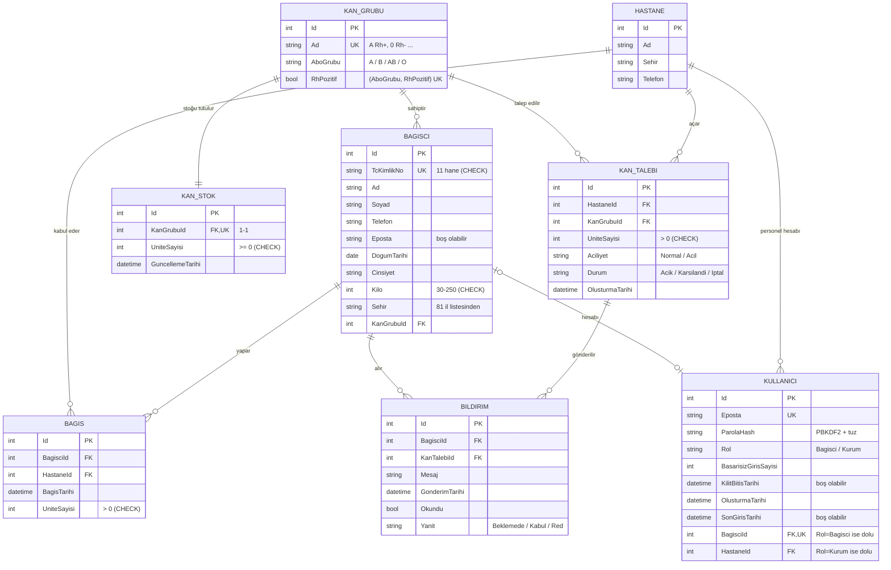

# ER Diyagramı

> **PK** birincil anahtar · **FK** yabancı anahtar · **UK** benzersiz (unique)

## Varlıklar

| Varlık | Açıklama |
|---|---|
| **KanGrubu** | 8 kan grubunun tutulduğu sabit tablo. ABO grubu ve Rh faktörü ayrı alanlarda tutulur; uyumluluk bu ikisinden hesaplanır (Hafta 6). |
| **Bagisci** | Sisteme kayıtlı gönüllü bağışçı. |
| **Hastane** | Kan talebi açan ve bağış kabul eden kurum. |
| **KanStok** | Her kan grubu için eldeki ünite sayısı. |
| **KanTalebi** | Hastanenin belirli bir kan grubu için açtığı talep. |
| **Bagis** | Bağışçının yaptığı her bağışın kaydı (bağış geçmişi). |
| **Bildirim** | Talebin uygun bağışçıya iletilmesi ve bağışçının yanıtı. |
| **Kullanici** | Sisteme giriş yapan hesap (Hafta 5). Rolüne göre bir bağışçıya ya da hastaneye bağlıdır. |

## İlişkiler

| İlişki | Tür | Silme davranışı | Açıklama |
|---|---|---|---|
| KanGrubu – KanStok | **1-1** | Restrict | `KanStok.KanGrubuId` benzersiz olduğu için her kan grubunun tek bir stok kaydı vardır. |
| KanGrubu – Bagisci | **1-N** | Restrict | Bağışçısı olan kan grubu silinemez. |
| KanGrubu – KanTalebi | **1-N** | Restrict | |
| Hastane – KanTalebi | **1-N** | Restrict | |
| Hastane – Bagis | **1-N** | Restrict | |
| Bagisci – Bagis | **1-N** | Restrict | Bağış geçmişi kayıt niteliğindedir, silinmez. |
| Bagisci – Kullanici | **1-1** (isteğe bağlı) | Cascade | Her bağışçının en fazla bir hesabı olur (`BagisciId` benzersiz). Örnek veri bağışçılarının hesabı yoktur. |
| Hastane – Kullanici | **1-N** | Restrict | Bir hastanenin birden çok personel hesabı olabilir. |
| Bagisci – KanTalebi | **N-N** | Cascade | **Bildirim** ara tablosuyla çözülür. `(BagisciId, KanTalebiId)` benzersizdir. |

## Hafta 4'te yapılan model düzeltmeleri

| Değişiklik | Neden |
|---|---|
| `Hastane` tablosu eklendi; `KanTalebi`'nden `HastaneAdi` ve `Sehir` çıkarıldı | **3NF ihlali vardı:** Şehir bilgisi talebe değil hastaneye bağlıydı (geçişli bağımlılık), aynı hastane bilgisi her talepte tekrar ediyordu. |
| `Bagis` tablosu eklendi; `Bagisci.SonBagisTarihi` kaldırıldı | Son bağış tarihi bağış kayıtlarından hesaplanabilir. Ayrıca saklamak **gereksiz tekrar (denormalizasyon)** olur ve iki değer zamanla tutarsızlaşabilir. Bağış geçmişi de kayda geçmiş olur. |

## Anahtarlar ve normalizasyon

- Her tablonun **birincil anahtarı (PK)** `Id`'dir. TC kimlik no gibi doğal anahtarlar PK yapılmaz, **benzersiz (unique)** kısıtla korunur. Böyle anahtarlar değişebilir ve gizli kalması gereken bilgi içerir.
- İlişkiler **yabancı anahtarlarla (FK)** kurulur. Yabancı anahtar, olmayan bir kayda bağlantı yapılmasını engeller (**referans bütünlüğü**).
- **1NF:** Her alan tek bir değer tutar.
- **2NF:** Tekli PK kullanıldığı için kısmi bağımlılık oluşmaz.
- **3NF:** Anahtar olmayan alanlar başka bir anahtar olmayan alana bağlı değildir. Kan grubu ve hastane bilgisi ayrı tablolarda tutulur, diğer tablolarda yalnızca Id'leri bulunur.
