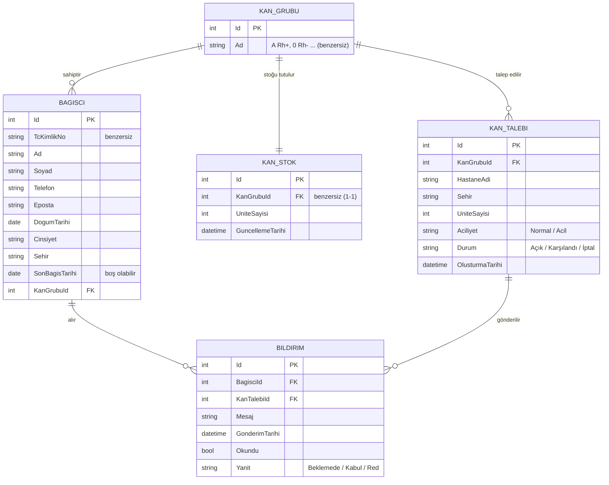

# ER Diyagramı

## Varlıklar

| Varlık | Açıklama |
|---|---|
| **KanGrubu** | 8 kan grubunun tutulduğu sabit tablo (A Rh+, A Rh-, B Rh+, B Rh-, AB Rh+, AB Rh-, 0 Rh+, 0 Rh-). |
| **Bagisci** | Sisteme kayıtlı gönüllü bağışçı. |
| **KanStok** | Her kan grubu için eldeki ünite sayısı. |
| **KanTalebi** | Hastanenin belirli bir kan grubu için açtığı talep. |
| **Bildirim** | Bir talebin uygun bağışçıya iletilmesi ve bağışçının yanıtı. |

## İlişkiler

| İlişki | Tür | Açıklama |
|---|---|---|
| KanGrubu – KanStok | **1-1** | Her kan grubunun tek bir stok kaydı vardır (`KanStok.KanGrubuId` benzersiz). |
| KanGrubu – Bagisci | **1-N** | Bir kan grubunda çok bağışçı olabilir, her bağışçının tek bir kan grubu vardır. |
| KanGrubu – KanTalebi | **1-N** | Bir kan grubu için çok talep açılabilir. |
| Bagisci – KanTalebi | **N-N** | Bir talep çok bağışçıya, bir bağışçıya çok talep bildirilebilir. Bu ilişki **Bildirim** ara tablosuyla çözülür. |

## Anahtarlar ve normalizasyon

- Her tablonun kendi **birincil anahtarı (PK)** `Id` vardır. TC kimlik no gibi doğal anahtarlar değişebilir ya da gizli kalması gerekebilir, bu yüzden tanımlayıcı olarak kullanılmaz. Bunun yerine **benzersiz (unique)** kısıtla korunur.
- İlişkiler **yabancı anahtarlarla (FK)** kurulur: `KanGrubuId`, `BagisciId`, `KanTalebiId`.
- **1NF:** Her alan tek bir değer tutar. Örneğin bir bağışçının birden fazla telefonu ayrı sütunlara bölünmez.
- **2NF:** Tekli PK kullanıldığı için kısmi bağımlılık oluşmaz.
- **3NF:** Kan grubu adı bağışçı, stok ve talep tablolarında tekrar edilmez, yalnızca `KanGrubuId` tutulur. Kan grubu adı değişirse tek bir yerden güncellenir.
