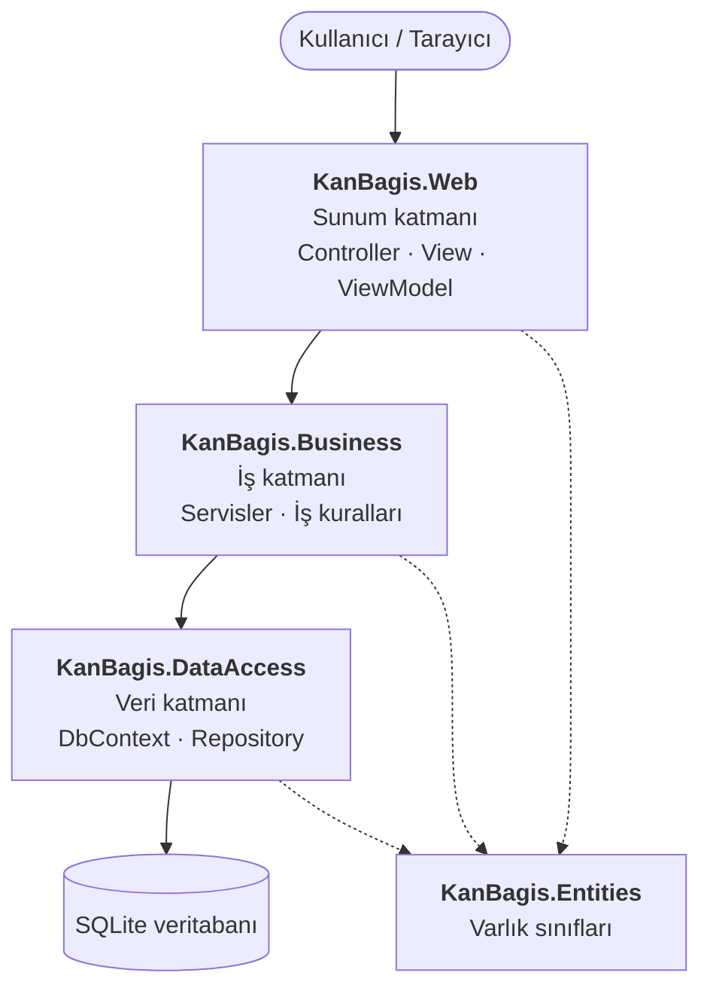

# Mimari Şema

Proje **katmanlı mimari** (sunum / iş / veri) ile kurulmuştur.

## Katmanlar

| Proje | Katman | Sorumluluk |
|---|---|---|
| `KanBagis.Web` | Sunum | HTTP isteklerini karşılar, sayfaları gösterir. Veritabanına doğrudan erişmez. |
| `KanBagis.Business` | İş | Kuralları uygular. Örnek kurallar: bağışçı iki bağış arasında en az 3 ay bekler, stok yetersizse uygun bağışçılara bildirim gönderilir. |
| `KanBagis.DataAccess` | Veri | Entity Framework Core ile veritabanına okuma ve yazma işlemlerini yapar. |
| `KanBagis.Entities` | Ortak | Tablolara karşılık gelen sınıfları (Bagisci, KanTalebi…) tutar. Tüm katmanlar bu projeyi kullanır. |

## Neden katmanlı mimari?

- **Sorumluluk ayrımı:** Her katmanın tek bir işi vardır. Bir hatanın hangi katmandan kaynaklandığı kolayca bulunur.
- **Bağımlılık tek yönlüdür:** Web → Business → DataAccess. Alt katman üst katmanı tanımaz.
- **Değiştirilebilirlik:** SQLite'tan SQL Server'a geçmek yalnızca DataAccess katmanını etkiler.
- **Test edilebilirlik:** İş kuralları arayüzden bağımsız olarak test edilebilir.
