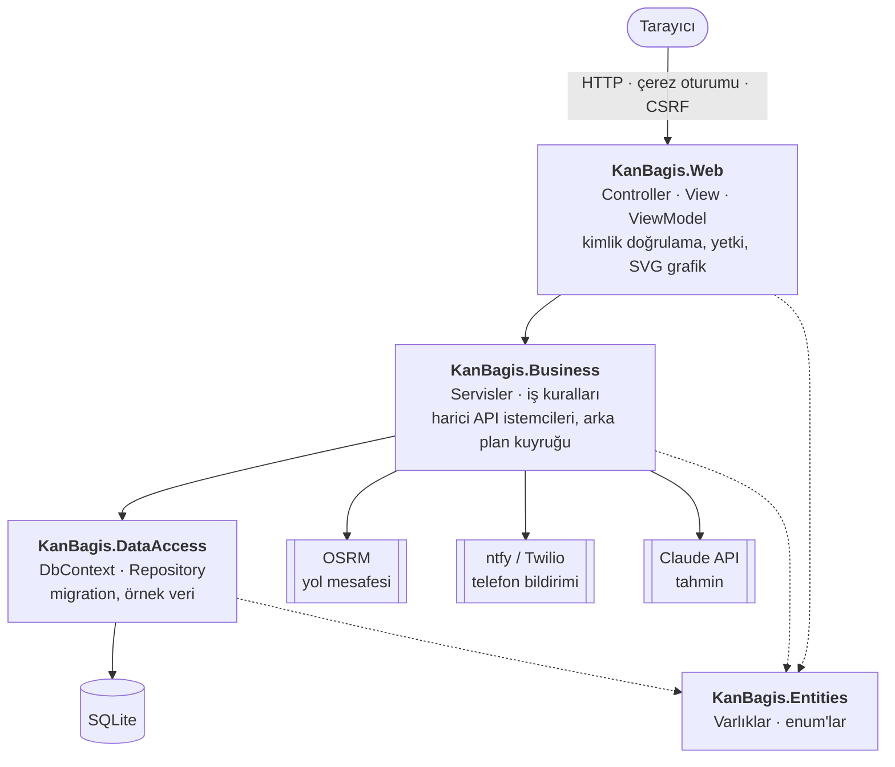
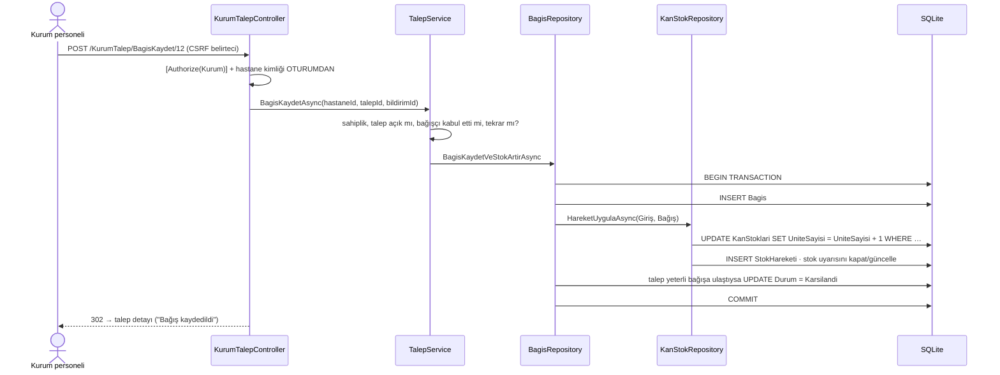

# Mimari

Proje **katmanlı mimari** (sunum / iş / veri) ile kuruludur. Bu belge v0.7.0 itibarıyla günceldir.

## Katmanlar

| Proje | Sorumluluk | Bilmediği şey |
|---|---|---|
| `KanBagis.Web` | HTTP isteğini karşılar, oturumdaki kimliği (rol, hastane, bağışçı) okur, servisi çağırır, sayfayı çizer | Veritabanı, SQL, iş kuralı |
| `KanBagis.Business` | İş kurallarının tamamı: uygunluk, eşleştirme, stok kuralları, metrikler, yapay zekâ doğrulaması | HTTP, HTML |
| `KanBagis.DataAccess` | EF Core ile okuma/yazma, transaction, toplulaştırma sorguları, migration'lar | İş kuralı (yalnızca veri bütünlüğü kısıtları) |
| `KanBagis.Entities` | Tablolara karşılık gelen sınıflar, enum'lar, basit alan kuralları (`KanStok.DurumHesapla`) | Hiçbir katman |

**Bağımlılık tek yönlü:** Web → Business → DataAccess. Web, veri katmanını yalnızca `AddBusiness()` üzerinden dolaylı olarak kaydeder.

## Modüller

| Modül | Web | Business | DataAccess | Belge |
|---|---|---|---|---|
| Kimlik ve yetki | `HesapController` | `KimlikService`, `ParolaHasher` | `KullaniciRepository` | [Güvenlik notu](Guvenlik-Notu.md) |
| Bağışçı ve kan grubu | `BagisciPanelController`, `KanGrubuController` | `BagisciService`, `BagisUygunlukKurali`, `KanGrubuUyumlulugu` | `BagisciRepository` | [modül](moduller/Bagisci-ve-Kan-Grubu-Modulu.md) |
| Talep ve eşleştirme | `KurumTalepController`, `KurumPanelController` | `TalepService`, `EslestirmeService`, `BildirimService`, `AciliyetKurallari` | `KanTalebiRepository`, `BildirimRepository`, `BagisRepository` | [modül](moduller/Talep-ve-Eslestirme-Modulu.md) |
| Harici servisler | — | `OsrmMesafeServisi`, `NtfyKanali`, `TwilioSmsKanali`, `DisBildirimGonderici` + arka plan servisi | `BildirimRepository` | [Harici API](Harici-API.md) |
| Yapay zekâ tahmini | `TahminController` | `TahminService`, `IstatistikselTahmin`, `TahminIstemi`, `CiktiDogrulayici`, `AnthropicLlmIstemcisi` | `TahminRepository` | [Yapay zekâ](Yapay-Zeka-Bileseni.md) |
| Stok takip ve uyarı | `StokController`, menü rozeti | `StokService` | `KanStokRepository` (atomik hareket + uyarı) | [modül](moduller/Stok-Takip-ve-Uyari-Modulu.md) |
| İstatistik panosu | `IstatistikController`, `SvgGrafik` | `IstatistikService`, `MetrikHesap` | `IstatistikRepository` (GROUP BY) | [modül](moduller/Istatistik-Panosu.md) |

## Bir isteğin yolu: "Bağış alındı"

Bir adım başarısız olursa transaction geri alınır: "bağış kaydedildi ama stok artmadı" gibi yarım durum oluşmaz.

## Tasarım kararları

| Karar | Neden |
|---|---|
| Katmanlı mimari | Sorumluluk ayrımı; iş kuralları arayüzden bağımsız test edilir (testlerin %87'si HTTP'siz). |
| SQLite | Kurulum gerektirmez, tek dosya; ders projesi ölçeğine uygun. Tek yazıcı sınırı bilinçli kabul edildi ([Hata kayıtları](test/Hata-Kayitlari.md) A-03). SQL Server'a geçiş yalnızca DataAccess'i etkiler. |
| Kurallar hem serviste hem veritabanında | Servis kullanıcıya anlaşılır mesaj verir; CHECK kısıtları, benzersiz indeksler ve atomik güncellemeler eşzamanlı isteklerde bile tutarlılığı garanti eder (H13-04). |
| Kimlik oturumdan, formdan değil | Sahiplik: kullanıcı formdaki gizli alanı değiştirerek başka hastane adına işlem yapamaz. |
| Harici servisler kapalıyken de çalışma | Mesafe → kuş uçuşu, yapay zekâ → istatistiksel tahmin, SMS → yalnızca site içi bildirim. |
| Zamanlar UTC saklanır, takvim günü Türkiye saatine göre | `TurkiyeZamani` (H13-01). |
| Grafikler sunucuda SVG | Harici JavaScript kütüphanesi yok; çevrimdışı çalışır, içerik testte doğrulanır. |
