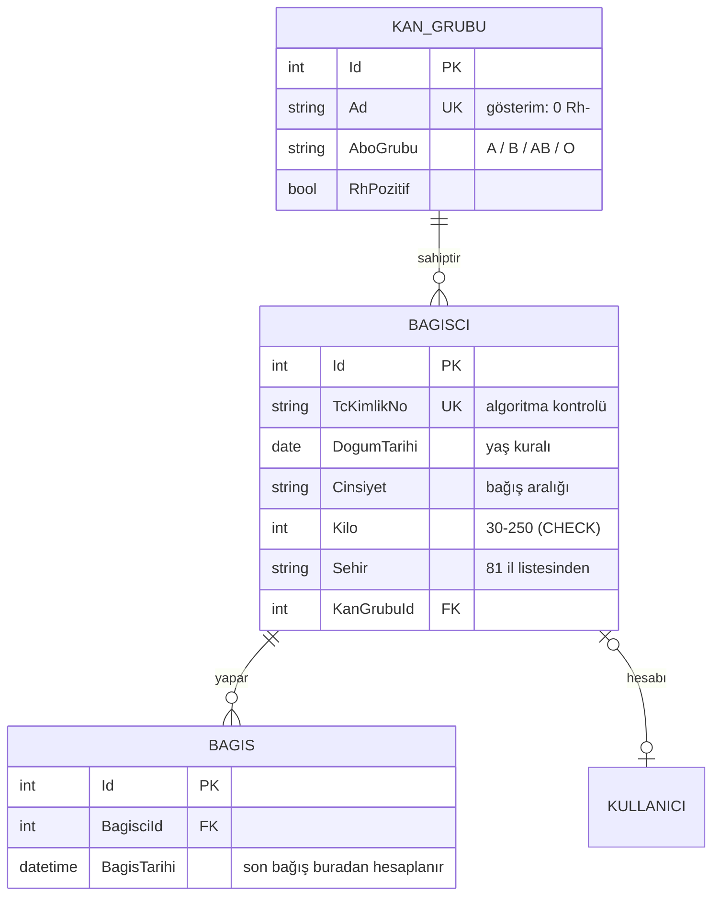

# Modül A: Bağışçı Kaydı ve Kan Grubu Yönetimi

Bu modül bağışçının kaydını, profilini ve kan grubu bilgisini yönetir. Ayrıca bir bağışçının **bugün kan bağışı yapıp yapamayacağına** karar verir.

## 1. Veri modeli

**Kan grubunu nasıl modelledim?** Kan grubu "0 Rh-" gibi tek bir metin olarak değil, iki ayrı alan olarak tutuluyor: **ABO grubu** (`A`, `B`, `AB`, `O`) ve **Rh faktörü** (`RhPozitif`). Uyumluluk bu iki alandan hesaplanıyor. Metin karşılaştırmasıyla "0 Rh- herkese verebilir" kuralı kurulamazdı. `(AboGrubu, RhPozitif)` çifti benzersiz tutuluyor, `Ad` alanı yalnızca ekranda gösterim için.

**Son bağış tarihi neden ayrı bir sütun değil?** Bu bilgi `Bagislar` tablosundan `MAX(BagisTarihi)` ile hesaplanıyor. Ayrı bir sütunda tutulsaydı iki kopya zamanla birbirini tutmayabilirdi (denormalizasyon).

## 2. İş kuralları

| Kural | Neden | Kod |
|---|---|---|
| **Bağış aralığı:** erkek 90 gün, kadın 120 gün | Türk Kızılay ölçütü. Kadınlarda demir depoları daha geç yenilenir. | [BagisUygunlukKurali.cs](../../src/KanBagis.Business/Bagiscilar/BagisUygunlukKurali.cs) |
| **Yaş 18–65** | Bağış için yasal ve tıbbi sınır | Aynı dosya |
| **Kilo en az 50 kg** | Bir ünite (yaklaşık 450 ml) kan alınması düşük kilolu kişi için risklidir | Aynı dosya |
| **Kan grubu uyumluluğu** | 0 Rh- herkese verebilir, AB Rh+ herkesten alabilir, Rh+ kan Rh- alıcıya verilemez | [KanGrubuUyumlulugu.cs](../../src/KanBagis.Business/Bagiscilar/KanGrubuUyumlulugu.cs) |
| **İlk bağıştan sonra kan grubu kilitlenir** | Bağışta kan grubu laboratuvarda test edilir. Sonradan değiştirilirse yanlış gruba kan çağrısı gönderilebilir. | [BagisciService.cs](../../src/KanBagis.Business/Bagiscilar/BagisciService.cs) |
| **Kayıt için en az 18 yaş** | Reşit olmayanlar bağışçı olamaz | [KimlikService.cs](../../src/KanBagis.Business/Kimlik/KimlikService.cs) |

Uygunluk kuralı, bağışçı uygun değilse **tüm nedenleri** ve **ne zaman uygun olacağını** döndürür. Bağışçı panelinde bu bilgiler gösteriliyor, örneğin: "Son bağışınızın üzerinden en az 120 gün geçmelidir. Uygun olacağınız tarih: 18.12.2026". Kilo ya da 65 yaş üstü gibi kendiliğinden düzelmeyen bir engel varsa tarih verilmez.

## 3. Doğrulama

Doğrulama iki yerde yapılıyor:
1. **Formda** (kullanıcıya hemen geri bildirim vermek için)
2. **İş katmanında** (asıl güvence; form atlanıp istek doğrudan gönderilse bile çalışır)

| Alan | Kural |
|---|---|
| TC kimlik no | 11 hane, ilk hane 0 değil, 10. ve 11. haneler algoritmaya uygun |
| Doğum tarihi | Kayıt için en az 18 yaş |
| İl | 81 il listesinden biri. Serbest metin kabul edilmiyor, çünkü "bingol" ile "Bingöl" eşleşmez. |
| Telefon | 0 ile başlayan 11 hane |
| Kilo | 30–250 (veri girişi sınırı, veritabanında CHECK kısıtı da var) |
| Kan grubu | Veritabanında var olan bir grup |

Örnek verideki TC numaraları (`999…`) algoritmaya **bilerek uymuyor**. Böylece hiçbir zaman gerçek bir kişinin numarası olamazlar (KVKK).

## 4. Erişim ve sahiplik

- Profil sayfası yalnızca `Bagisci` rolüne açık (`[Authorize(Roles = Roller.Bagisci)]`).
- Hangi kaydın güncelleneceği **formdan değil oturumdan** belirleniyor. Formda `BagisciId` alanı yok. Saldırgan forma başkasının Id'sini eklese bile yalnızca kendi kaydı değişir. Bunu bir test kanıtlıyor.
- Ad, soyad, TC, doğum tarihi ve cinsiyet kimlik bilgisi olduğu için profil sayfasından değiştirilemez. TC ekranda maskeli gösteriliyor: `100*****146`.
- Kurum panelinde bağışçıların adı gösterilmiyor, yalnızca **sayıları** gösteriliyor (KVKK: veri minimizasyonu).

## 5. Diğer modüllerle entegrasyon

| Modül | Bağlantı |
|---|---|
| Kimlik doğrulama (Hafta 5) | Kayıt formu bu modülün doğrulama kurallarını kullanıyor. Bağışçı kimliği oturum çerezinden okunuyor. |
| Kurum paneli | Her kan grubu için hastanenin ilinde **bugün bağış yapabilecek uyumlu bağışçı sayısı** gösteriliyor (`UygunBagiscilariBulAsync`). |
| Eşleştirme (sonraki haftalar) | `IBagisciService.UygunBagiscilariBulAsync(kanGrubuId, il)` kan talebi açıldığında kime bildirim gönderileceğini belirleyecek. Uyumluluk, il ve uygunluk kurallarını tek yerden uygular. |
| Herkese açık sayfa | `/KanGrubu`: kan grubu uyumluluk tablosu. Tablo aynı kural koduyla üretiliyor. |

## 6. Testler

[BagisciModuluTestleri.cs](../../tests/KanBagis.Tests/BagisciModuluTestleri.cs):
- 8×8 kan grubu uyumluluk tablosu
- Uygunluk sınırları: 89/90 gün (erkek), 119/120 gün (kadın), 65/66 yaş, 49/50 kg
- TC algoritması ve 81 il listesi
- Profil güncelleme, kan grubu kilidi, geçersiz verinin reddi
- Uyumlu bağışçı bulma: örneğin AB Rh+ talebinde tüm gruplar aranır, ama 120 gün kuralına takılan bağışçı elenir

[YetkilendirmeTestleri.cs](../../tests/KanBagis.Tests/YetkilendirmeTestleri.cs): formda başkasının Id'si gönderilse bile yalnızca kendi kaydın değişmesi (sahiplik), kurumun bağışçı profiline erişememesi ve kurum panelinde isim görünmemesi.
