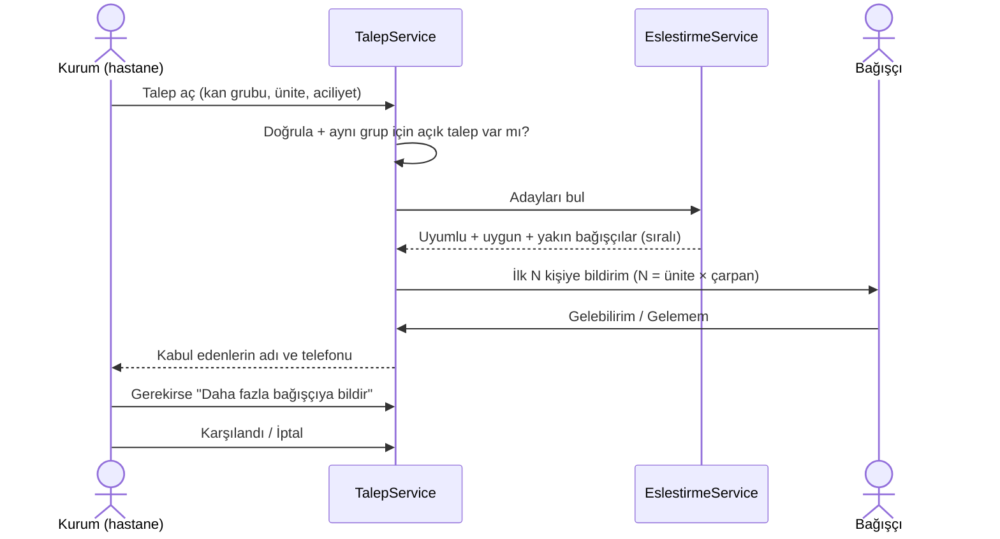
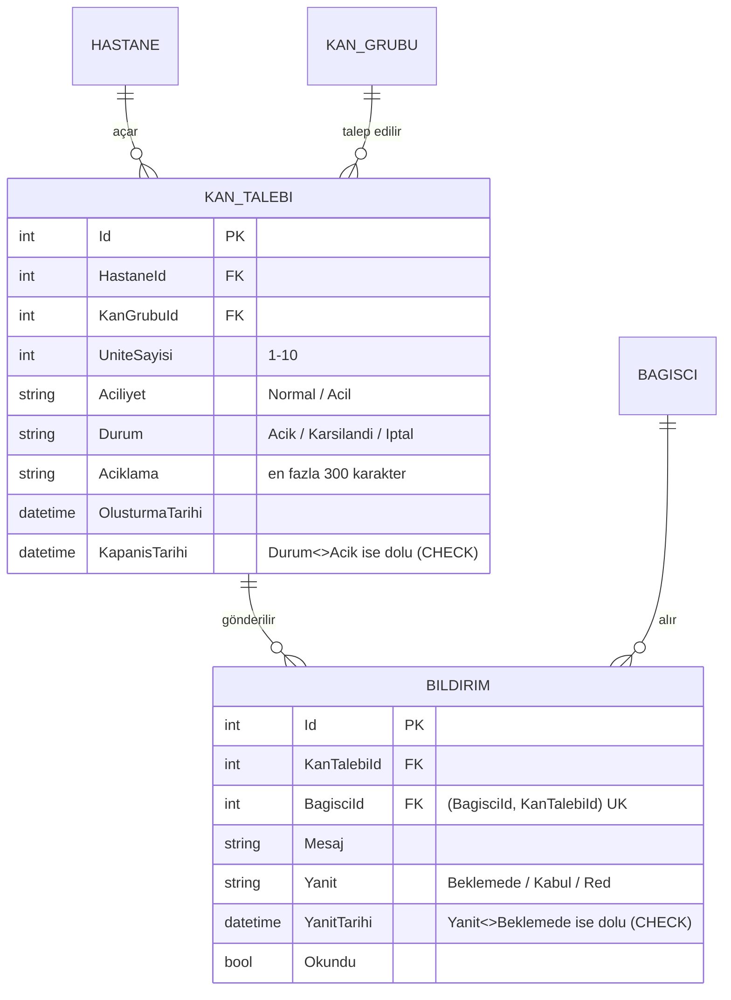

# Modül B: Talep ve Grup/Konum Eşleştirme

Bu modül, hastanenin açtığı kan talebini uygun bağışçılarla eşleştirir, bağışçılara bildirim gönderir ve verdikleri yanıtları toplar.

## 1. Akış

## 2. Veri modeli

- **Bildirim**, Bağışçı ile Kan Talebi arasındaki **N-N ilişkinin ara tablosu**. `(BagisciId, KanTalebiId)` çifti benzersiz, yani aynı talep aynı kişiye iki kez gönderilemez.
- **Durum ve tarih tutarlılığı veritabanında da korunuyor.** Kapanmış talebin kapanış tarihi, yanıtlanmış bildirimin de yanıt tarihi olmak zorunda (CHECK kısıtları).
- **Konum il düzeyinde tutuluyor.** Bağışçının adresi saklanmıyor (KVKK: veri minimizasyonu). 81 ilin merkez koordinatları kodda sabit bir tablo olarak duruyor ([IlKonumlari.cs](../../src/KanBagis.Business/Konum/IlKonumlari.cs)).

## 3. Eşleştirme algoritması

[EslestirmeService.cs](../../src/KanBagis.Business/Talepler/EslestirmeService.cs)

| Adım | Ne yapılıyor | Neden |
|---|---|---|
| 1. Grup uyumluluğu | Alıcıya kan verebilecek **tüm** gruplar bulunur. Örneğin A Rh+ talebi için A Rh+, A Rh-, 0 Rh+ ve 0 Rh- aranır. | Yalnızca aynı grup aransaydı uygun bağışçıların çoğu kaçırılırdı. |
| 2. Konum | Hastanenin ilinden aciliyete göre yarıçap içindeki iller bulunur. Mesafe Haversine formülüyle hesaplanır. | Bağışçının hastaneye ulaşabilmesi gerekir. |
| 3. Veritabanı | Bu gruplardan ve bu illerden bağışçılar **tek sorguyla** çekilir, son bağış tarihi de aynı sorguda gelir. | Performans: `(KanGrubuId, Sehir)` indeksi kullanılır. |
| 4. Uygunluk | Yaş, kilo ve son bağış kuralı uygulanır (Modül A). | Bağış yapamayacak kişiye çağrı gönderilmez. |
| 5. Sıralama | a) **mesafe** (yakın önce) → b) **tam grup eşleşmesi** önce → c) **en uzun süredir bağış yapmayan** önce → d) Id | Aşağıda açıklanıyor. |

**Sıralama kurallarının gerekçesi:**
- **Mesafe önce:** Yakındaki bağışçının gelme olasılığı da gelme hızı da daha yüksek.
- **Tam grup önce:** 0 Rh- kan herkese verilebilir ama nadir bulunur (nüfusun yaklaşık %7'si). A Rh+ talebine önce A Rh+ bağışçılar çağrılır; 0 Rh- bağışçılar yalnızca onların verebileceği talepler için saklanır.
- **En uzun süredir bağış yapmayan önce:** Yük bağışçılar arasında adil dağılır. Hiç bağış yapmamış bağışçı listenin başına gelir.
- **Id:** Aynı veriyle her çalıştırmada aynı sonuç alınsın diye.

## 4. Aciliyet nasıl önceliklendiriliyor?

[AciliyetKurallari.cs](../../src/KanBagis.Business/Talepler/AciliyetKurallari.cs)

| | Normal | Acil |
|---|---|---|
| Arama yarıçapı | 100 km | **300 km** |
| Ünite başına bildirim | 3 kişi | **5 kişi** |
| Bildirim metni | — | "ACİL:" ile başlar |
| Kurum listesi | | Açık talepler arasında **en üstte** |
| Bağışçı listesi | | Yanıt bekleyenler arasında **en üstte**, kırmızı arka planla |

Ünite başına birden çok kişiye bildirim gönderilmesinin nedeni, bildirim alan herkesin gelememesi. Acil talepte kaybedilecek zaman olmadığı için daha çok kişiye ilk seferde ulaşılıyor.

## 5. İş kuralları

| Kural | Neden | Kod |
|---|---|---|
| Bir hastane aynı kan grubu için **ikinci bir açık talep açamaz** | Aynı bağışçılar aynı ihtiyaç için iki kez çağrılırdı ve kurum ihtiyacı iki yerden takip etmek zorunda kalırdı | `TalepService.OlusturAsync` |
| Bir bağışçı **aynı anda yalnızca bir açık talebi kabul edebilir** | Bir kişi tek seferde bir kez bağış yapabilir. İki talebi birden kabul ederse hastanelerden biri gelmeyecek birini bekler. | `BildirimService.YanitlaAsync` |
| Kabul anında uygunluk **yeniden** kontrol edilir | Bildirim gönderildikten sonra bağışçının durumu değişmiş olabilir | `BildirimService.YanitlaAsync` |
| "Daha fazla bildir" aynı kişiye **tekrar göndermez** | Bağışçı aynı talep için iki kez rahatsız edilmez | `TalepService.DahaFazlaBildirAsync` |
| Kapanmış talebe bildirim gönderilmez, yanıt verilmez, talep yeniden kapatılmaz | Talebin yaşam döngüsü yalnızca Açık → Karşılandı/İptal yönünde ilerler | `TalepService`, `BildirimService` |
| Talep ve ilk bildirimler **tek transaction** içinde kaydedilir | Talep oluşup bildirimlerin oluşmaması gibi yarım bir durum yaşanmaz | `TalepService.OlusturAsync` |

**Doğrulama:** Ünite 1–10 arasında olmalı, kan grubu veritabanında var olmalı, aciliyet geçerli bir değer olmalı, açıklama en fazla 300 karakter olmalı. Kurallar formda ve iş katmanında ayrı ayrı kontrol ediliyor.

## 6. Erişim, sahiplik ve KVKK

- Talep sayfalarına yalnızca `Kurum` rolü, yanıt verme işlemine yalnızca `Bagisci` rolü erişebilir.
- Hastane ve bağışçı kimliği **oturumdan** okunur. İş katmanı her işlemde talebin o hastaneye, bildirimin o bağışçıya ait olduğunu kontrol eder.
- Başka hastanenin talebi **404** döndürür, böylece talebin var olduğu bile belli edilmez. Başkasının bildirimi için de "Bildirim bulunamadı." mesajı gösterilir.
- Kurum, bağışçının **adını ve telefonunu yalnızca bağışçı talebi kabul ettikten sonra** görür (açık rıza). Yanıt bekleyen ya da reddeden bağışçıların sadece sayısı görünür.
- Açıklama alanının altında "hasta adı yazmayın" uyarısı var.

## 7. Diğer modüllerle entegrasyon

| Modül | Bağlantı |
|---|---|
| A: Bağışçı ve Kan Grubu (Hafta 6) | Eşleştirme `KanGrubuUyumlulugu` ve `BagisUygunlukKurali`'nı **yeniden kullanır**; aynı kurallar iki ayrı yerde yazılmaz. |
| Kimlik (Hafta 5) | Rol kontrolü, hastane ve bağışçı kimliği oturum çerezinden okunur. |
| Veritabanı (Hafta 4) | `Bildirim` N-N tablosu ve benzersiz indeks. Hafta 4'te eklenen `(KanGrubuId, Sehir)` indeksi aday sorgusunda kullanılıyor. |
| Kurum paneli | Talep listesi (kabul/ünite, bildirim sayısı), ildeki uygun bağışçı sayıları. |
| Bağışçı paneli | Kan çağrıları listesi, "Gelebilirim" ve "Gelemem" düğmeleri. Bağışçı bağışa uygun değilse kabul düğmesi pasif olur. |

## 8. Testler

[EslestirmeTestleri.cs](../../tests/KanBagis.Tests/EslestirmeTestleri.cs):
- Mesafe (Bingöl–Elazığ, İstanbul–Ankara), yarıçap, 81 ilin koordinatı
- Uyumlu grup araması, tam grup önceliği, acil talepte genişleyen yarıçap, eşitlikte adil sıralama
- Talep doğrulama, mükerrer talep kuralı, kota, "daha fazla bildir", sahiplik, kapatma, CHECK kısıtı
- Yanıt: sahiplik, kapanmış talep, tek aktif kabul, kabul anında uygunluk

[YetkilendirmeTestleri.cs](../../tests/KanBagis.Tests/YetkilendirmeTestleri.cs): kurumun formdan talep açması, bağışçının kabul etmesi ve kurumun telefonu görmesi (uçtan uca); başka kurumun talep detayının 404 vermesi; bağışçının talep açamaması ve başkasının bildirimini yanıtlayamaması.
